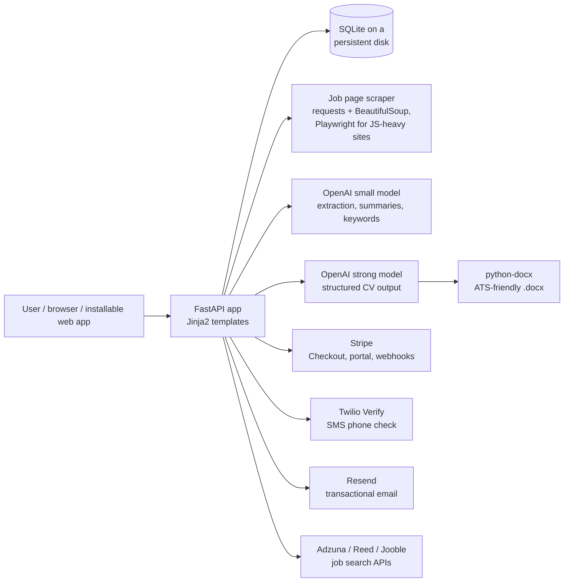

# Trabo: AI-tailored CVs for UK job seekers

**Live:** [trabo.app](https://trabo.app) · **Status:** live in production · **Source:** private (it's a live business), available to reviewers on request

Trabo writes a tailored, ATS-friendly CV for each job a person applies to. It scores the CV against the job's keywords and keeps every application in one dashboard. I designed, built and run it by myself, from the first commit to production: the product, backend, AI pipeline, payments, deployment and legal/privacy compliance.

<!-- Add a screenshot or GIF here, e.g.  -->

---

## What it does

1. **Upload a CV once** (PDF or Word), or build one in the free CV builder.
2. **Save jobs** by pasting a link from any job site, searching UK job boards in the app, or using a "Save to Trabo" bookmarklet.
3. **Click Generate** to get a CV rewritten for that job, as a Word file built to be read correctly by applicant tracking systems.
4. **See the ATS report**: which of the job's keywords the CV now covers and which are missing. If the user really has a missing skill, they can tick it and the CV is regenerated with it.
5. **Track the application** through Saved → Applied → Interviewing → Offer.

There are also free tools that bring in visitors from search: a rule-based **ATS CV checker** (no AI calls, so it costs nothing to run), a **CV builder** and **CV example pages** for common UK jobs.

## The AI part

The hard problem is that **a CV tool that makes things up is worse than useless.** A candidate who is caught with an invented skill in an interview loses the job. Most of the AI engineering went into keeping the model truthful and the output consistent.

- **Two-stage pipeline.** A small, cheap model (`gpt-4.1-mini`) does the high-volume work: extracting job details from scraped pages, summarising postings and pulling out ATS keywords. A stronger model writes the CV itself, because that's the part users pay for.
- **Structured outputs.** The CV is generated straight into a Pydantic schema (`responses.parse` with `text_format=…`), so the app never parses free text and every CV has the same sections.
- **Grounding rules in the prompt.** The model may only use facts in the candidate's own CV: no invented employers, dates, numbers or tools, and it must never claim the target job's title. Matched keywords use the posting's exact wording (e.g. "worked with stakeholders" → "stakeholder management"), and acronyms are written both ways ("Search Engine Optimisation (SEO)") so either form matches.
- **User-confirmed skills.** Keywords the CV doesn't support are shown as missing, never silently added. The user can confirm the skills they really have, and those are stored on their profile and used in every future CV.
- **Choosing the model by evaluation.** I compared models side by side on real CVs. `gpt-4.1-mini` overstated candidates' experience, and `gpt-5.4-mini` barely tailored the bullet points. `gpt-5.5` was the first that tailored the CV properly while staying truthful, so it writes the CVs. The model is a config setting, so it can be changed without touching code.
- **Deterministic clean-up after generation.** A post-processing step fixes casing and formatting that models get inconsistent (ALL CAPS, title case for skills, full stops on bullets) before the Word file is built.
- **ATS-safe rendering.** The Word file is built with `python-docx`: a single column, real body text, standard section names, and no tables, text boxes, headers or images, because many ATS parsers skip or scramble those.

## Architecture

## Tech stack

| Area | Tools |
|---|---|
| Backend | Python, FastAPI, SQLAlchemy, Pydantic, Jinja2 |
| AI | OpenAI Responses API with structured outputs |
| Documents | python-docx (output), pypdf (CV parsing) |
| Scraping | requests, BeautifulSoup/lxml, Playwright (headless Chromium) |
| Payments | Stripe Checkout, customer portal, webhook-synced subscriptions |
| Messaging | Twilio Verify (SMS), Resend (email) |
| Infra | Docker, Render (auto-deploy from `main`, persistent disk, health check) |
| Testing | pytest: auth, billing, emails, phone verification, CV generation, legal/privacy |

## Engineering highlights

- **Abuse prevention for the free plan.** Free users verify a mobile number by SMS before their first tailored CV, and each number can only be verified on one account. Sending is rate-limited per account and per number so the form can't be used to spam someone.
- **Subscriptions that stay in sync.** Stripe webhooks are the source of truth for each user's Pro status. There's a one-time welcome discount for new accounts.
- **Security basics done properly.** bcrypt password hashing, signed session cookies, HTTPS-only cookies in production, a session timeout after inactivity with a "remember me" option, and an ownership check on every job and CV route.
- **UK compliance.** Marketing emails are opt-out under PECR (Privacy and Electronic Communications Regulations), one-click unsubscribe works, and there's a data protection complaints form as the Data (Use and Access) Act 2025 requires.
- **Built to be found.** SEO landing pages, a sitemap, CV example pages for 12 common UK jobs, per-channel tracking links, and an `/llms.txt` summary so AI assistants can describe the product accurately.
- **Works on phones.** It's an installable web app (home-screen icon, standalone mode), with downloads that work in standalone mode on iOS.

## What I learned

- **Prompting isn't enough on its own.** You need a schema so the output can't drift, post-processing for what the model gets inconsistent, and a product design (confirmed skills) that removes the model's reason to make things up.
- **Pick models by testing on real inputs**, and use different models for different jobs based on cost and quality.
- **Production is a lot more than the model call.** Payments, abuse prevention, email deliverability, privacy law and mobile edge cases took more of the work than the AI did.

---

Built by **Beatrice Varga** · [LinkedIn](https://www.linkedin.com/in/beatrice-varga-a8) · Happy to walk through the code in an interview.
